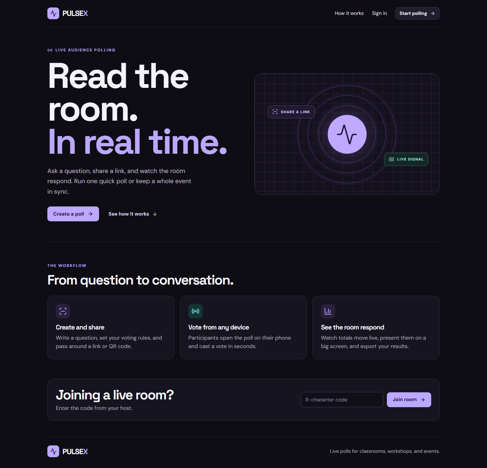
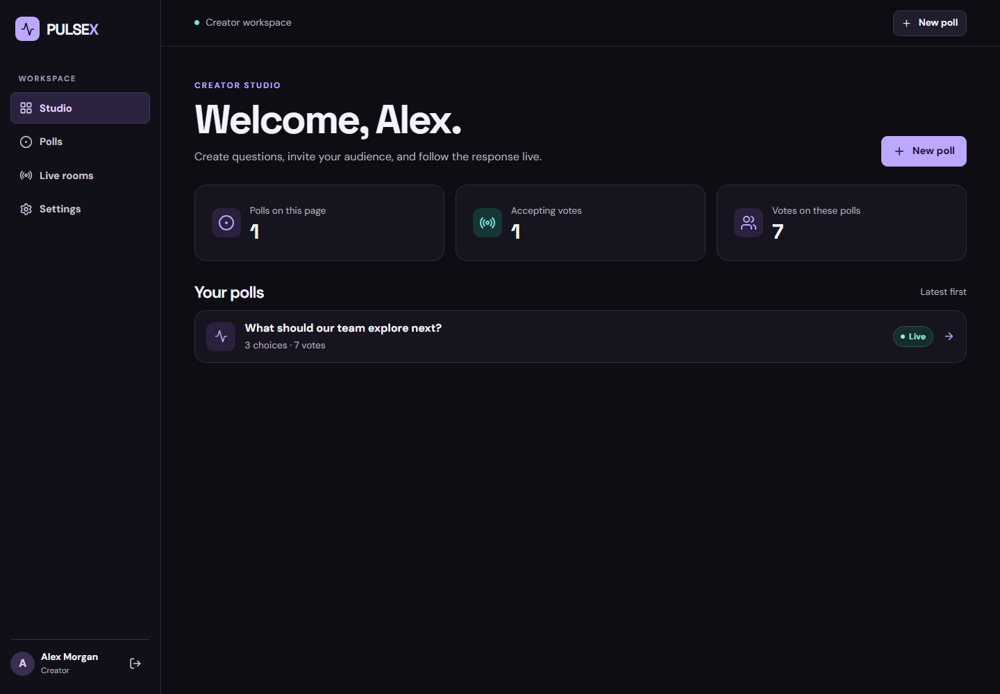
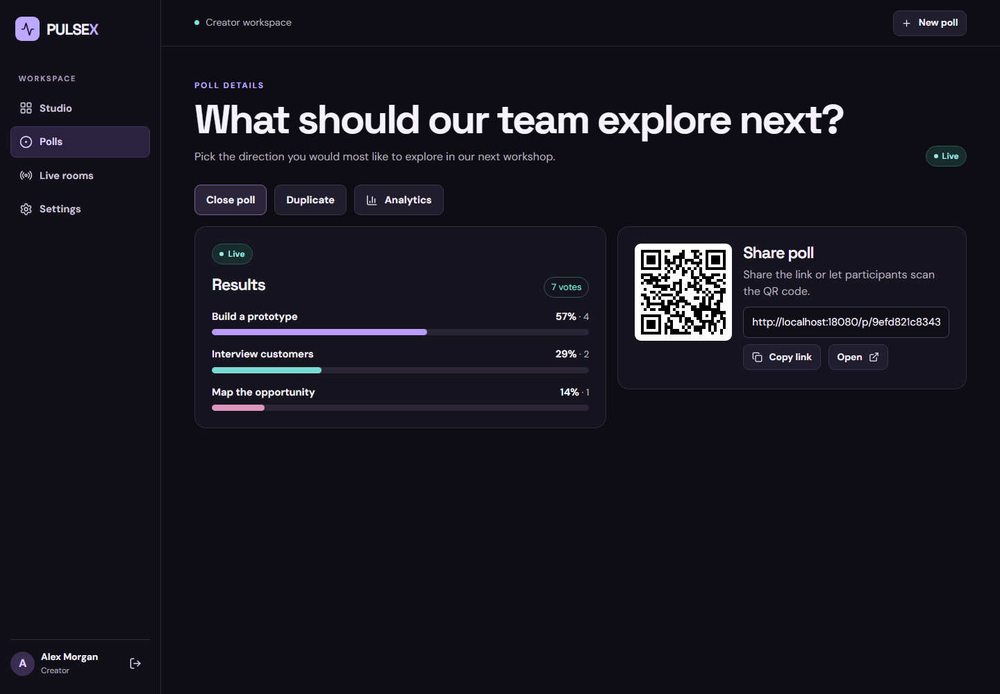
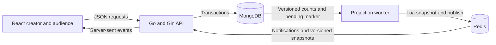

<p align="center"></p>

<h1 align="center">PULSEX</h1>
<p align="center"><strong>Read the room. In real time.</strong></p>
<p align="center">Live audience polling for classrooms, workshops, and events.</p>

[](https://github.com/Sanjayram3269/Pulsex/actions/workflows/ci.yml)



PULSEX lets creators publish a question, share a link or QR code, and watch answers arrive live. Host several questions in one room, give participants one link, and show a synchronized presentation while voting is open.

## What you can do

| Area | Capabilities |
| --- | --- |
| **Identity** | Create an account, sign in and out, update your profile, and manage polls and rooms within your workspace. |
| **Studio** | Draft, preview, edit, duplicate, publish, close and archive single-choice polls. Schedule voting, set audience result visibility, and share a link or QR code. |
| **Live** | Vote from a phone as a guest or signed-in participant according to poll rules. Watch visible results update without a reload, including after reconnecting. |
| **Arena** | Arrange polls in a room, invite with a code or QR, advance the active question, set a deadline, track approximate presence and present results full-screen. |
| **Insights** | View answer distribution, total votes and hourly participation from the vote ledger. Export per-choice totals to CSV. |

| Creator Studio | Live results |
| --- | --- |
|  |  |

[Poll editor](docs/screenshots/editor.png) · [Mobile voting](docs/screenshots/mobile-vote.png) · [Analytics](docs/screenshots/analytics.png)

## Run locally

Requires Docker with Compose. Node 22 and Go 1.26 are useful for development and local checks.

```bash
git clone https://github.com/Sanjayram3269/Pulsex.git
cd Pulsex
docker compose up -d --build --wait
```

Open **http://localhost:8080**. Register, start a draft with at least two choices, publish it, and open the audience link in a private browser window. Cast a vote there while the creator detail page is open. The creator sees the count update via SSE.

```bash
docker compose ps
curl -fsS http://localhost:8080/api/v1/ready
docker compose down
```

Compose keeps MongoDB data in a volume. Redis is ephemeral by design in the local stack, so restarts exercise projection recovery. The host port binds to loopback. If 8080 is already occupied, set both `HTTP_PORT=18080` and `APP_ORIGIN=http://localhost:18080` in a local `.env` before running Compose.

### Environment

| Name | Purpose |
| --- | --- |
| `APP_ORIGIN` | Exact browser origin, with no trailing slash. Local defaults to `http://localhost:8080`. |
| `COOKIE_SECURE` | Set `true` for public HTTPS. Local defaults to `false`. |
| `MONGO_URI`, `MONGO_DB` | Transaction-capable MongoDB connection and database. Local Compose initializes `rs0` and uses `pulsex`. |
| `REDIS_URL` | Redis connection URL. Use `rediss://` if the service requires TLS. |
| `GUEST_SECRET` | Stable, at least 32 bytes. Generate a private value for public deployments. |
| `HTTP_PORT`, `PORT` | Local host port or hosting-provider runtime port. |
| `RUN_WORKER` | Enables the projection worker inside the API when set to `true`. Compose uses a separate worker. |
| `TRUSTED_PROXY_CIDRS` | Optional comma-separated list for verified reverse-proxy networks. |
| `STATIC_DIR` | SPA assets directory. The Docker build sets `/srv`. |

See [`.env.example`](.env.example) and the [operations guide](docs/operations.md).

## Architecture



The vote transaction updates the poll aggregate, sets a pending marker, and inserts a uniquely indexed ballot. Duplicate-key rejection rolls back the aggregate update. The worker then writes a full, versioned count snapshot to Redis. Its Lua script stores the highest revision and publishes an update atomically. MongoDB keeps one recoverable marker per poll, and the worker clears it only after the exact revision has been projected. Replaying a job replaces a missing snapshot or leaves the existing revision intact.

Each API replica uses one Redis subscription and bounded per-spectator buffers. Initial connection, reconnection, and periodic heartbeat checks reconcile the current snapshot. Redis transport can drop messages and the next read or update repairs the view. The vote ledger and counts survive Redis loss.

The hot-poll write contention point is the MongoDB poll document. The single-origin deployment simplifies cookie handling and keeps the SPA, API and SSE under one HTTPS origin. Guest deduplication is browser-level. Account-required polls deduplicate by account.

[Architecture, indexes and failure recovery](docs/architecture.md) · [Threat model](docs/security.md) · [Operations](docs/operations.md)

## API

The [OpenAPI specification](docs/openapi.yaml) documents `/api/v1`. Readiness at `GET /api/v1/ready` checks both dependencies. Creator endpoints use a session cookie. Mutating requests must send the configured `Origin`, and requests with a body use `application/json`.

| Request | Purpose |
| --- | --- |
| `POST /api/v1/auth/register` | Register and set the creator cookie. |
| `POST /api/v1/polls` | Save a validated draft. |
| `POST /api/v1/polls/{id}/action` | Publish, close, archive, or duplicate. |
| `GET /api/v1/public/polls/{slug}` | Get public metadata and initialize the guest cookie. |
| `POST /api/v1/public/polls/{slug}/votes` | Cast a vote. Body example is `{"choice":0}`. |
| `GET /api/v1/public/polls/{slug}/events` | Stream state and visible results. |

A successful vote returns HTTP 201 with `{"accepted":true}`. A duplicate returns HTTP 409 with an error code of `already_voted`. An SSE message contains a full state snapshot such as `{"version":7,"state":"live","counts":[3,2]}`. The counts field is omitted when result visibility requires it.

## Verify

Run against a disposable local Compose project. The integration checks create test records and the rate-limit check consumes the localhost vote allowance for up to a minute.

```bash
cd backend
go test ./...
go vet ./...
go run golang.org/x/vuln/cmd/govulncheck@v1.10.0 ./...

cd ../frontend
npm ci
npm run build
npm audit --audit-level=moderate
npx playwright install chromium
npm run test:e2e

cd ..
node scripts/verify.mjs --recovery --rate-limit
```

Set `BASE_URL` if using a different local origin. Run the browser suite before the rate-limit check. See the [verification report](docs/verification.md) for measurements and the [k6 scenario](scripts/load.js) for an isolated burst against a fresh guest-enabled poll.

## Deploy

The root Dockerfile builds both applications, then copies the Go binaries and SPA into a non-root runtime image. Deploy it to a Docker-compatible web service with a MongoDB replica set and Redis. Configure HTTPS, a stable guest signing key, the exact public origin, health checks, and an active projection worker. [Deployment and incident guide](docs/operations.md)

**Public deployment status:** awaiting authenticated hosting access and managed data services.

## Assignment and AI disclosure

The core React, Gin, MongoDB and Redis flow, production configuration, verification, and submission status are tracked in the [assignment checklist](docs/verification.md). The submission also requires a working public deployment and a publicly viewable 3–5-minute video. [Demo walkthrough](docs/demo.md)

OpenAI Codex generated the initial implementation, test code and documentation. It ran real services, used failed checks to identify issues, and iterated on the code. The presenter should describe their own contribution and review truthfully.
